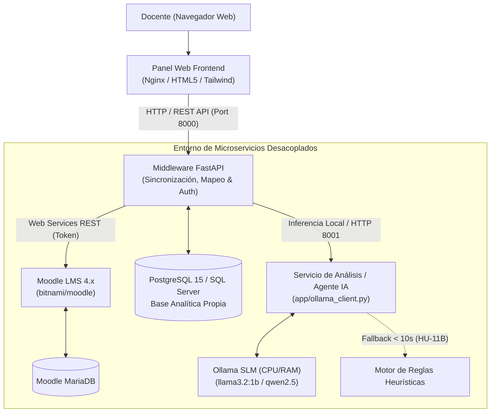

# Capa Inteligente de Seguimiento Académico para Moodle (Middleware + Agente IA)

[](https://github.com/AlanZamora10/Metodolog-a-giles/actions/workflows/ci.yml)
[](https://www.docker.com/)
[](https://fastapi.tiangolo.com/)
[](https://www.postgresql.org/)
[](https://ollama.com/)

**Institución:** Universidad Técnica de Ambato (UTA)  
**Facultad:** Facultad de Ingeniería en Sistemas, Electrónica e Industrial (FISEI)  
**Carrera:** Ingeniería de Software  
**Asignatura:** Metodologías Ágiles  
**Docente:** Ing. Hernán Naranjo, Mg.  
**Metodología:** Scrum (Sprints semanales)  
**Versión:** 1.0 (Sprint 1 - Envisioning, diseño y entorno base)

---

## 1. Equipo de Desarrollo y Roles (Sprint 1)

| Integrante | Rol Scrum | Responsabilidad Técnica en Sprint 1 |
| :--- | :--- | :--- |
| **Alan Zamora** | Scrum Master & Developer | Calidad de software, pruebas automatizadas, Integración Continua (GitHub Actions) y gestión de ceremonias. |
| **Justin Ojeda** | Developer | Configuración de Git, entorno Dockerizado base, estructura del backend/middleware y desarrollo de HU-01. |
| **Johan Borja** | Developer | Arquitectura de microservicios, esquema relacional de base de datos analítica y desarrollo de HU-01. |
| **Alvaro Moreta** | Proxy-PO & Developer | Diseño de UI/UX minimalista, prototipado de componentes frontend (Mockups 1, 2 y 3). |

---

## 2. Descripción y Justificación del Proyecto

Los promedios generales suelen ocultar situaciones académicas críticas individuales. Un curso de 7 estudiantes puede registrar un promedio aparentemente saludable de 7.0/10, mientras 2 o 3 estudiantes se encuentran reprobando severamente con notas de 3.5 o 4.5. El docente, al observar únicamente el promedio general, no detecta oportunamente a quienes requieren apoyo pedagógico temprano.

Este proyecto implementa una **Capa Inteligente desacoplada** compuesta por:
1. **Middleware de Integración:** Extrae y normaliza calificaciones y entregas de Moodle mediante Web Services REST sin sobrecargar el LMS.
2. **Base de Datos Analítica Propia:** Almacena datos académicos desagregados por parciales, unidades temáticas y componentes ponderados oficiales.
3. **Servicio de Análisis y Agente IA Local:** Ejecuta inferencia con modelos SLM livianos (vía Ollama en CPU/RAM sin costo de API) y un motor de reglas heurísticas de respaldo de alta disponibilidad (< 10 s).
4. **Panel Web Minimalista:** Interfaz orientada al docente con semaforización de tres niveles (Crítico, En Riesgo, Aceptable) y generador de refuerzos pedagógicos.

---

## 3. Arquitectura del Sistema (Microservicios)



---

## 4. Estructura del Repositorio

```text
MoodleProyecto/
├── .github/
│   └── workflows/
│       └── ci.yml               # Pipeline de GitHub Actions (Linter + Pytest + Docker)
├── .gitignore                   # Exclusiones completas para Python, Docker, Node y Entorno
├── .env.example                 # Plantilla de variables de entorno documentada
├── .env                         # Variables de entorno locales
├── docker-compose.yml           # Orquestación de contenedores en la raíz
├── README.md                    # Documentación técnica y tabla de avance
│
├── docker/                      # Definiciones docker modulares
│   ├── docker-compose.yml       # Compose modular alternativo
│   ├── Dockerfile.middleware    # Imagen FastAPI Python 3.11
│   ├── Dockerfile.agent         # Imagen Agente IA Python 3.11
│   └── Dockerfile.frontend      # Imagen Nginx para UI
│
├── database/                    # Scripts de inicialización de Base de Datos
│   ├── init.sql                 # Esquema relacional PostgreSQL + Seeds HU-01
│   └── seeds/
│       └── seed_hu01.sql        # Script SQL de validación específica de HU-01
│
├── middleware/                  # Microservicio Middleware (FastAPI / Python 3.11)
│   ├── Dockerfile
│   ├── requirements.txt
│   ├── pyproject.toml
│   ├── app/
│   │   ├── main.py              # Punto de entrada FastAPI con CORS y prefijo /api/v1
│   │   ├── config.py            # Gestión de configuraciones con Pydantic Settings
│   │   ├── services/
│   │   │   ├── grade_calculator.py  # Cálculo oficial UTA: (40% Aut. + 30% Tar. + 30% PAE)
│   │   │   ├── id_parser.py         # Parser convención: [MATERIA]-[PARCIAL]-[UNIDAD]-[TEMA]
│   │   │   └── moodle_client.py     # Cliente HTTP Web Services de Moodle
│   │   ├── schemas/             # Modelos de datos Pydantic
│   │   └── routers/             # Endpoints: /health, /students, /courses, /sync, /logs
│   └── tests/                   # Pruebas unitarias automatizadas (Pytest)
│       ├── test_grade_calculator.py
│       ├── test_id_parser.py
│       ├── test_hu01_acceptance.py
│       └── test_api_endpoints.py
│
├── agent/                       # Microservicio de Análisis y Agente IA
│   ├── Dockerfile
│   ├── requirements.txt
│   ├── app/
│   │   ├── main.py              # API microservicio Agente en puerto 8001
│   │   ├── ollama_client.py     # Inferencia SLM con timeout estricto de 10s
│   │   └── heuristics.py        # Motor de respaldo con reglas deterministas (HU-11B)
│   └── tests/
│       └── test_heuristics.py
│
├── frontend/                    # Frontend Minimalista (Mockups 1, 2 y 3 interactivos)
│   ├── Dockerfile
│   ├── nginx.conf               # Configuración de servidor web con proxy API
│   └── index.html               # Panel del Docente, Detalle Alumno y Publicación Refuerzos
│
└── scripts/                     # Herramientas de automatización CLI
    ├── seed_moodle_course.py    # Script ejecutable de simulación y validación de HU-01
    └── verify_hu01.py           # Verificador automatizado para CI/CD
```

---

## 5. Implementación de la Historia de Usuario HU-01

### Criterio de Aceptación (Formato Gherkin):
> **Dado** que existe una instancia de Moodle en contenedor y el script de carga del curso de prueba  
> **Cuando** el administrador ejecuta la carga del curso simulado  
> **Entonces** el curso contiene **2 materias**, **7 estudiantes**, **2 parciales** y **4 unidades** (categorías de calificación "Unidad 1" a "Unidad 4"), cada actividad tiene un **ID number normalizado** `[MATERIA]-[PARCIAL]-[UNIDAD]-[TEMA]` y **al menos 2 estudiantes tienen nota ponderada menor a 5.0 (casos críticos)**.

### Muestra de Estudiantes y Calificaciones Cargadas:
Fórmula oficial UTA: **Nota Final = (0.40 × Autónomo) + (0.30 × Tareas) + (0.30 × PAE)**

| ID | Estudiante | Autónomo (40%) | Tareas (30%) | PAE (30%) | Nota Final | Nivel de Riesgo | Detalle Pedagógico |
| :---: | :--- | :---: | :---: | :---: | :---: | :---: | :--- |
| `U-03` | Estudiante A | 8.00 | 8.00 | 8.00 | **8.00** | `ACEPTABLE` | Rendimiento óptimo sostenido |
| `U-04` | Estudiante B | 8.50 | 8.50 | 8.50 | **8.50** | `ACEPTABLE` | Rendimiento sobresaliente |
| `U-05` | **Estudiante C** | 3.50 | 3.00 | 4.00 | **3.50** | `CRITICO` ⚠️ | Falencia severa en Unidad 2 (Tema 2.3 = 2.0) |
| `U-06` | **Estudiante D** | 4.50 | 4.00 | 5.00 | **4.50** | `CRITICO` ⚠️ | Falencias en Unidad 1 (Tema 1.1 = 3.5) |
| `U-07` | Estudiante E | 8.00 | 7.00 | 7.67 | **7.60** | `ACEPTABLE` | Rendimiento regular aprobatorio |
| `U-08` | Estudiante F | 6.50 | 6.00 | 6.00 | **6.20** | `EN_RIESGO` ⚠️ | Zona de riesgo fronterizo (5.0 a 6.9) |
| `U-09` | Estudiante G | 8.50 | 8.00 | 8.70 | **8.41** | `ACEPTABLE` | Rendimiento alto con tendencia ascendente |

---

## 6. Despliegue y Ejecución Local

### Prerrequisitos:
- Docker y Docker Compose instalados (`docker --version`).
- Python 3.11 o superior (para pruebas y scripts locales).
- Git (`git --version`).

### Paso 1: Clonar y configurar variables de entorno
```bash
git clone https://github.com/AlanZamora10/Metodolog-a-giles.git
cd Metodolog-a-giles
cp .env.example .env
```

### Paso 2: Despliegue de los servicios con Docker Compose
```bash
docker compose up -d
```

### Servicios expuestos:
- **Panel Web Frontend:** [http://localhost:3000](http://localhost:3000)
- **Middleware FastAPI (Docs Swagger):** [http://localhost:8000/docs](http://localhost:8000/docs)
- **Middleware Healthcheck:** [http://localhost:8000/api/v1/health](http://localhost:8000/api/v1/health)
- **Moodle LMS:** [http://localhost:8080](http://localhost:8080)
- **Base Analítica PostgreSQL:** `localhost:5432` (Usuario: `analytics_user`, Base: `moodle_analytics`)
- **SQL Server (Contenedor Adicional):** `localhost:1433` (Usuario: `sa`)
- **Ollama SLM Local:** `localhost:11434`

### Paso 3: Ejecución y verificación del script HU-01
```bash
# Ejecutar verificación completa con tabla de resultados
python scripts/seed_moodle_course.py

# Verificación directa para pipelines CI
python scripts/verify_hu01.py
```

### Paso 4: Ejecución de pruebas automatizadas locales
```bash
pytest middleware/tests/ -v
pytest agent/tests/ -v
```

---

## 7. Tabla de Avance - Sprint 1 (Envisioning, diseño y entorno base)

| ID / Tarea | Responsable | Estimación | Estado | Entregable Verificable |
| :--- | :--- | :---: | :---: | :--- |
| **Repositorio Git y estructura** | Justin Ojeda | Tarea Base | **Completado** | Arquitectura limpia de microservicios y `.gitignore` |
| **Entorno Dockerizado base** | Justin Ojeda | Tarea Base | **Completado** | `docker-compose.yml` con Moodle, Postgres, SQLServer, FastAPI, Ollama, Frontend |
| **Esquema de Base de Datos inicial** | Johan Borja | Tarea Base | **Completado** | `database/init.sql` con esquema relacional, logs (HU-16) y alertas |
| **Implementación HU-01 (Curso simulado)** | Justin Ojeda & Johan Borja | **3 Pts** | **Completado** | `scripts/seed_moodle_course.py` con 7 estudiantes y 2 casos críticos |
| **Frontend Minimalista (Mockups 1, 2 y 3)** | Alvaro Moreta | Tarea Base | **Completado** | `frontend/index.html` interactivo, semáforos, evolución y refuerzos |
| **Integración Continua (CI)** | Alan Zamora | Tarea Base | **Completado** | `.github/workflows/ci.yml` con Linter, Pytest y validación Docker |
| **Documentación y Arquitectura** | Alan Zamora | Tarea Base | **Completado** | `README.md` técnico con diagramas y criterios de aceptación Gherkin |

---

## 8. Licencia
Este proyecto es desarrollado con fines académicos en la **FISEI - Universidad Técnica de Ambato**. Código abierto bajo licencia MIT.
